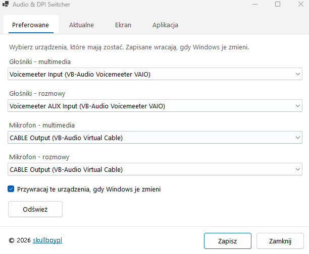
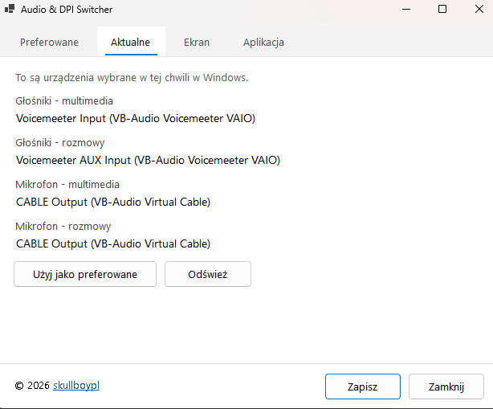
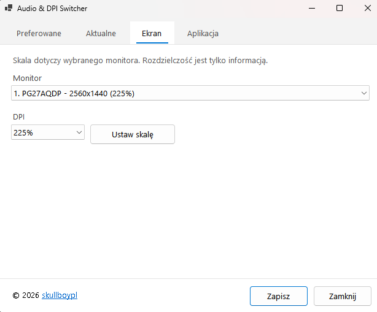
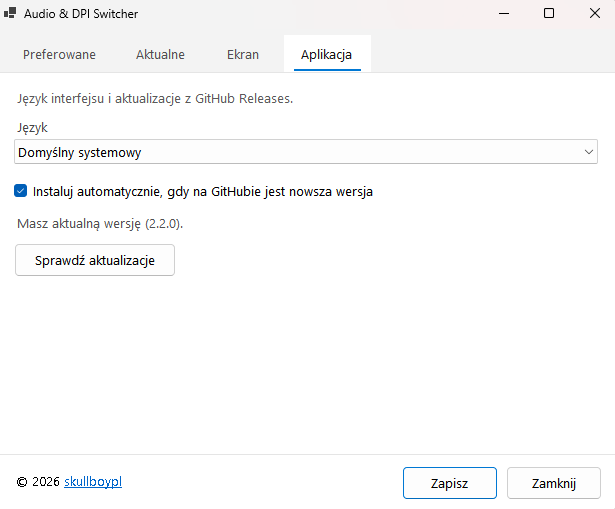

# AudioDpiSwitcher - Windows Audio Device Switcher and Per-Monitor DPI Tool

**AudioDpiSwitcher** is a lightweight **Windows 10/11 system tray app** (C# / .NET 8) for switching **default playback and recording devices**, locking preferred audio endpoints with **auto-restore**, and changing **per-monitor DPI scaling** without opening Windows Settings every time.

Ideal if you use multiple headphones, speakers, microphones, Voicemeeter, virtual cables, or multi-monitor setups and need fast control from the tray.

**Repository:** [github.com/skullboypl/AudioDpiSwitcher](https://github.com/skullboypl/AudioDpiSwitcher)  
**Author:** [skullboypl](https://github.com/skullboypl)  
**License:** MIT  
**Platform:** Windows 10 / Windows 11 (x64)

---

## Why AudioDpiSwitcher?

Windows often changes the default sound device after reconnecting USB headsets, docking, or opening communication apps. Display scaling is also buried in Settings and is awkward on multi-monitor desks.

AudioDpiSwitcher keeps preferred **media** and **communications** devices (speakers + mics) and can **automatically put them back** when Windows overrides them. DPI is applied **natively** via DisplayConfig APIs - no separate `SetDpi.exe` helper.

---

## Features

### Audio
- Set preferred **default playback** (multimedia) and **communications playback**
- Set preferred **default microphone** (multimedia) and **communications microphone**
- One-click **capture current Windows defaults** as preferred (tray + Settings)
- Optional **auto-restore** (~2.5s) when Windows switches devices away from your prefs
- Tray shortcut to classic **Windows Sound** panel (`mmsys.cpl`)

### Display DPI
- Native **per-monitor DPI / scaling** (100% - 400% presets, Win11-ready table)
- Monitor list shows **name, resolution, and current scale**
- Selection is preserved after applying a new DPI value
- Based on the same DisplayConfig approach as [SetDPI](https://github.com/imniko/SetDPI) / [lihas DPI sample](https://github.com/lihas/windows-DPI-scaling-sample), embedded in-process

### UX and localization
- Slim tray menu
- Settings in four tabs: **Preferred**, **Current**, **Display**, **App**
- Languages: **English**, **Polish**, **German** (or follow Windows UI language)
- Single **left-click** on the tray icon opens Settings
- **Auto-update** from GitHub Releases on published builds

---

## Tray menu

| Action | Description |
|--------|-------------|
| Settings | Open the settings window |
| Windows Settings | Open the classic Sound control panel |
| Set as defaults | Save the current Windows audio devices as preferred |
| Exit | Quit the app |

Left-click the tray icon to open Settings. Right-click for the menu.

---

## Settings window

The screenshots below are the Polish UI. English and German use the same layout.

| Preferred | Current |
| --- | --- |
| Devices to keep. Auto-restore puts them back when Windows changes them. | What Windows is using right now. One click saves that set as preferred. |
|  |  |

| Display | App |
| --- | --- |
| Per-monitor scale. The list shows name, resolution, and the current percent. | Language, sign-in startup, and updates from GitHub Releases. Save stores the options and closes the window. |
|  |  |

Published builds check GitHub on their own. When a newer `AudioDpiSwitcher.exe` is in Releases, the app downloads it, replaces itself, and restarts. The switch is on the **App** tab. A development build only reports the newer version and does not overwrite its own file.

Config path: `%APPDATA%\AudioDpiSwitcher\settings.json`

---

## Download and install

### From Releases (recommended)

1. Open [Releases](https://github.com/skullboypl/AudioDpiSwitcher/releases)
2. Download the latest signed `AudioDpiSwitcher.exe`
3. Run it - the icon appears in the Windows system tray

Release builds are intended to be **EV code signed** (see signing notes below).

### From source

Requirements: [.NET 8 SDK](https://dotnet.microsoft.com/download/dotnet/8.0)

```powershell
git clone https://github.com/skullboypl/AudioDpiSwitcher.git
cd AudioDpiSwitcher
dotnet run --project AudioDpiSwitcher\AudioDpiSwitcher.csproj
```

---

## Build release (single-file)

```powershell
.\build.ps1
.\sign.ps1
```

Output:

`AudioDpiSwitcher\bin\Release\net8.0-windows\win-x64\publish\AudioDpiSwitcher.exe`

`build.ps1` publishes a **self-contained, single-file** `win-x64` executable.  
`sign.ps1` is local-only (gitignored) and signs with your EV certificate via `signtool`.

---

## Technical overview

| Item | Detail |
|------|--------|
| Stack | C# , .NET 8 , Windows Forms |
| Tray | `NotifyIcon` |
| Audio | NAudio (`MMDeviceEnumerator`) + PolicyConfig COM for defaults |
| DPI | `DisplayConfigGetDeviceInfo` / `DisplayConfigSetDeviceInfo` (undocumented DPI IOCTLs) |
| Storage | `%APPDATA%\AudioDpiSwitcher\settings.json` |
| No PowerShell | Audio and DPI run in-process |

---

## Keywords

Windows audio switcher, default playback device, communications device, microphone switcher, system tray sound tool, per-monitor DPI, display scaling Windows 11, multi-monitor DPI, auto restore audio device, GitHub release auto-update, Voicemeeter helper, NAudio tray app, .NET 8 WinForms utility.

---

## Acknowledgements

- DPI scaling technique inspired by **lihas** and **[imniko/SetDPI](https://github.com/imniko/SetDPI)**

---

## License

This project is released under the **MIT License**. See [LICENSE](LICENSE).

Copyright (c) [skullboypl](https://github.com/skullboypl)
